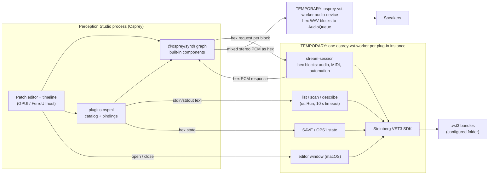
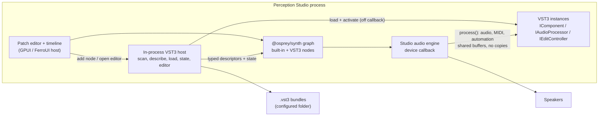

# Synth package: VST3 hosting and hosted graphs

## VST3 hosting [SYNTH-HOST-VST]

### 🚨 TEMPORARY WORKAROUND: THE VST3 WORKER IS NOT THE ARCHITECTURE [SYNTH-HOST-VST-TEMPORARY] 🚨

**Perception Studio cannot yet host VST3 plug-ins directly.** Until it can, every VST3 plug-in runs in an external `osprey-vst-worker` process (Perception Modular, [src/toolchain/hosts/synth_vst](../../../src/toolchain/hosts/synth_vst/README.md)). Studio talks to that process through stdin/stdout text sessions. This is a **stopgap, not the design.**

- ❌ Do not build new features on the worker, its hexadecimal transports (`stream-text`, `stream-session`, `OPS1`) or its `audio-device` queue. Fix only what keeps current hosting working until the in-process host replaces it.
- 🎯 The goal is [SYNTH-HOST-VST-INPROCESS]: Perception Studio loads VST3 modules into its own process and calls them from its own audio engine.
- 🗑️ When the in-process host passes the same journeys, the worker, its transports, its `audio-device` adapter and their tests are **deleted** in the same change. Nothing is kept for compatibility.
- 🔒 The worker does not sandbox anything. A plug-in in a separate process can still read files and use the network, so isolation is not a reason to keep it.

#### Now: plug-ins run in external worker processes [SYNTH-HOST-VST-WORKER-ARCH]

Every plug-in block makes a round trip through two processes and gets encoded as text twice. Output reaches the speakers through a second worker, not through Studio's own audio engine.

#### Target: VST3 host inside Perception Studio [SYNTH-HOST-VST-INPROCESS]

Studio loads each module, builds typed graph nodes from its buses and parameters, and calls `process()` from its own device callback with the graph's buffers. Scanning, loading, activation and state restore stay off the callback. Plug-in editors open as Studio child windows. There are no worker processes, no text transports and no separate device worker.

VST3 **hosting** (through the temporary worker above) is an active requirement of the [Perception expansion](../../plans/studio/studio.md). The isolated worker now scans, describes and processes real plug-ins, and Perception can create and route their typed graph nodes, then audition a real instrument/effect chain as stereo PCM. Continuous device rendering remains in progress. The purpose is to load existing VST3 instruments/effects into a synthesis graph. Producing Osprey VST3 plug-ins is a separate capability and is not substituted for hosting.

An external node declares audio buses, event buses, parameter identifiers, sample-accurate automation support, latency, tail length and saved state. Host adapters map these to the same graph ports and parameter Signals as built-in components. Plug-in metadata/parameter IDs remain stable across graph saves; missing binaries or changed layouts produce visible errors rather than loading a different plug-in silently.

Scanning, loading, activation and state restoration run outside the callback. The design must account for unsupported layouts, dynamic latency, bypass, crash/hang handling and untrusted plug-in code. Scan out of process; evaluate process isolation for playback with explicit latency/cost measurements. No claim that an arbitrary third-party plug-in respects Osprey's memory-safety or callback contract. Host integration includes actual DAW-style lifecycle and state/automation tests. Use the [official SDK](https://github.com/steinbergmedia/vst3sdk) as the compatibility source.

## Prepared grain samples [SYNTH-SAMPLES-IMPORT]

`SampleResources.decodeWave(name, rootNote, bytes)` is a pure preparation API returning an immutable `SampleResource` or an explicit error. It preserves source sample rate and original channel count, converts the caller's root MIDI pitch to a root frequency and validates finite normalised samples. The bounded WAV parser supports little-endian RIFF PCM 8/16/24/32 and float32, one or two channels, 8–192 kHz, 2–1048576 frames and at most 8 MiB. The returned buffer holds interleaved frames in their original channel order. The mono sampler and grain kernels use an equal-weight stereo mix. Resource identity includes both original sample words. Unknown chunks are skipped within checked lengths and padding, duplicate format/data chunks and truncated data are rejected, and compressed/extensible/RF64/RIFX formats are unsupported. This allocating reference importer runs outside rendering and has no filesystem or UI dependency.

`Components.granular` takes the resource rather than an unlabelled sample list. Its default playback rate compensates for the source rate at the graph's current 48 kHz output rate. Transposition uses source/output sample-rate ratio multiplied by target/root frequency ratio, independent of file length. `SampleResources.playbackRate` returns an explicit failure when the requested transposition exceeds the supported grain rate. The built-in periodic source declares its exact 46.875 Hz root. Resource identity/content hashes, persistence, asynchronous file selection and live swaps remain unimplemented; compile/static evidence does not establish numerical import correctness or realtime readiness. See [SYNTH-ADVANCED-GRAINS-IMPORT].

## Built-in oscillator MIDI input [SYNTH-HOST-MIDI-OSCILLATOR]

An oscillator node may declare an optional mono `Events/Notes` input; the built-in `Components.sine` factory stays input-free and an unwired oscillator uses its frequency parameter. In the shared block graph renderer, a wired oscillator is initially silent and consumes note events before their sample offset: positive-velocity note-on selects pitch and amplitude, while matching note-off or zero-velocity note-on closes the gate. Pitch uses equal temperament with A4 at 440 Hz. The reference implementation is monophonic, last-note priority without fallback to previously held notes. Note ownership includes channel, pitch and event identity; an unrelated note-off cannot silence the selected note. Oscillator phase and note ownership persist between blocks. Matching note-off starts a retained linear release of a fixed 5 ms at the graph's rate (240 frames at 48 kHz, 220 at 44.1 kHz); there is no public per-voice duration control yet. The first release sample retains full velocity and the last is exactly zero; release progresses across blocks. Repeated note-offs do not restart it, and unrelated note-offs leave it unchanged. A new positive-velocity note-on cancels the tail, retains oscillator phase and adopts the new note; there is no attack/crossfade or polyphonic fallback, so this is not a fully click-free voice implementation. Perception currently applies parameter edits after playback restart. Silent voices retain rather than advance their oscillator phase.

The scalar reference renderer accepts unwired oscillators but explicitly rejects connected event graphs; use `GraphClips` for MIDI rendering. Switching between wired and unwired modes requires a freshly prepared graph state; live topology state migration remains a separate routing requirement. An earlier build exposed a cyan MIDI socket on the original oscillator card and routed the existing MIDI note generator to it; manual native interaction connected `5:0 → 0:0` and completed an audition, and the device receipt reported four empty-queue callbacks, so sustained reliable playback is not established. Strict compilation and the native build passed; automated verification remains paused.

## Worker audio transport [SYNTH-HOST-STREAM]

`HostPackets` encodes checked interleaved float32 audio, MIDI and float64 normalized automation into the worker's little-endian protocol. Clips are split into at most 256-frame blocks; event offsets remain sample-accurate. The transport bounds channels, frame counts, notes and parameters before encoding. `HostResponses` checks the exact expected channel layout and frame count, finite samples, stable bounded latency and the absence of trailing data before exposing audio to the graph. Files and packets share `PcmWords`, and `WaveFiles.interleaved` records channel-aligned IEEE float32 PCM with a frame-count fact chunk.

The native worker accepts binary persistent streams or bounded hexadecimal clips over stdin/stdout. The text path has exact-PCM parity with binary processing. It is suitable for reference previews; it is not a realtime device callback implementation. The GPUI process-input adapter bounds transport memory and child lifetime independently of output EOF.

## Hosted graph clips [SYNTH-HOST-GRAPH]

`GraphClips` evaluates a frozen acyclic graph in dependency order, sharing the reference oscillator, filter, gain, mixer and delay kernels through `ClipKernels`. A hosted node suspends pure execution with its checked audio, MIDI and parameter request; the consuming application supplies a validated worker response before scheduling downstream nodes. Extra ports, missing cables, malformed cached buffers and excessive resources are errors. Explicit mono-to-stereo conversion is a component; a cable never changes channel count. This bounded offline path rejects feedback and nonzero plug-in latency rather than claiming realtime feedback or latency compensation.

## MIDI generators [SYNTH-HOST-MIDI]

A MIDI note component exposes whole-number pitch, normalized velocity and an exact gate length in frames. `MidiClips.window` assigns note-on and note-off to half-open sample windows, preserving ownership at block boundaries. Fractional pitches/gates, invalid velocities and out-of-range windows return errors. Event outputs connect only to compatible event inputs; audio outputs remain separate. Sequencing, polyphonic generators and continuous live note control remain delivery work.

## Hosted parameter modulation [SYNTH-HOST-MODULATION]

`HostModulation.connect` attaches an explicitly normalized control input to an automatable VST parameter and connects it transactionally. Parameters use stable native IDs, and incompatible sources are rejected without changing the previous graph. Disconnecting the cable retains the port for later routing and restores the configured parameter value. Non-automatable controls are displayed as unavailable for editing in this host; editing them is an explicit error rather than a silent no-op.

The clip renderer samples connected control streams on a 128-frame automation grid. Default values are sent once at frame zero; connected parameters receive exact offsets and normalized values at subsequent grid points. A clip has a bounded total of 1024 points, and excess automation returns an error. This is a declared control update interval, not a promise that every plug-in interpolates identically. The native JX10 journey captures the exact filter-frequency points and compares the resulting audio against a replay with only the initial control setting retained.
